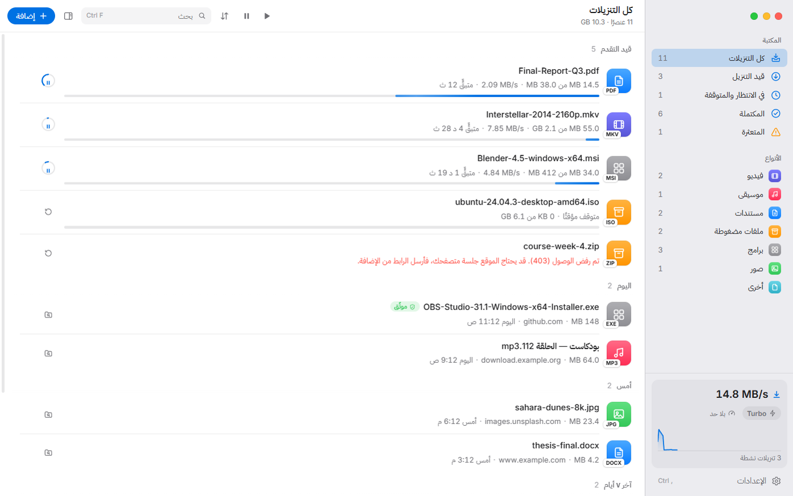

# واصل — Wasel Download Manager

مدير تنزيلات سريع وأنيق ومجاني لنظام Windows، بتصميم مستوحى من Apple وواجهة عربية أولًا.

**الموقع:** https://mouadkennedy2001.github.io/wasel-download-manger/ · **التنزيل:** [أحدث إصدار](https://github.com/mouadkennedy2001/wasel-download-manger/releases/latest)



## ما الجديد في الإصدار 2

- **وضع Turbo**: ‏32 اتصالًا لكل ملف دون حد للسرعة، لاستغلال كامل سرعة الإنترنت في جهازك.
- **تنزيل أي رابط**: إن كان الرابط صفحة ويب وليس ملفًا، يستخرج واصل منها الفيديوهات والصوت والملفات ويعرضها لتختار، أو ينزّل الفيديو الرئيسي تلقائيًا باسم الصفحة.
- **روابط البث (HLS / m3u8)**: يختار أعلى جودة، وينزّل الأجزاء بالتوازي، ويفك تشفير AES-128، ويجمعها في ملف `.ts` واحد قابل للاستئناف.
- **تقسيم ديناميكي**: كل اتصال ينهي جزءه يأخذ نصف أكبر جزء متبقٍّ، والملف يُكتب مباشرة في مكانه دون خطوة دمج.
- **المواقع التي كانت ترفض التنزيل تعمل الآن**: هوية متصفح حديث (User-Agent)، ملفات تعريف الارتباط عبر التحويلات، صفحة الإحالة، شهادات Windows، دعم وكيل النظام، والتعرف على صفحات تسجيل الدخول بدل حفظها كملفات تالفة.
- **إعادة المحاولة تلقائيًا** مع الاستئناف من حيث توقف، حتى بعد إعادة تشغيل الجهاز.
- **إضافة متصفح جديدة** تتصل بواصل مباشرة وترسل جلسة تسجيل الدخول، مع قائمة «Download with Wasel» عند النقر بالزر الأيمن.
- **واجهة جديدة بالكامل** بأسلوب macOS: شريط جانبي شفاف (Mica على Windows 11)، لوحة معلومات مع خريطة الاتصالات ورسم السرعة، فاتح وداكن وثمانية ألوان تمييز.
- **جدولة** بأيام وساعات بدء وإيقاف، و«عند الانتهاء» (إنهاء، سكون، إيقاف التشغيل)، وتحديد السرعة، ومراقبة الحافظة، وسلاسل مرقّمة مثل `file[1-50].jpg`، وبصمات التحقق (SHA-256/SHA-1/MD5).
- **التحديث التلقائي يعمل فعلًا**: انظر القسم التالي.

## لماذا لم تكن التحديثات تصل؟

1. كانت اختبارات المشروع تفشل (ملف `lang/eng.json` محذوف)، فلم يعمل مسار النشر في GitHub Actions، ورُفع ملف `.exe` يدويًا.
2. الإصدار المرفوع يدويًا لا يحتوي `latest.yml`، وهو الملف الذي يقرأه المحدّث. بدونه لا يعرف أي تطبيق مثبّت أن هناك تحديثًا.
3. كانت الإعدادات تعامل المستودع كأنه خاص وتطلب `GH_TOKEN` على جهاز كل مستخدم، مع أن المستودع عام.

**الحل:** لا ترفع ملفات الإصدار يدويًا. حدّث `version` في `package.json` ثم ادفع وسمًا مطابقًا:

```bash
git tag v2.0.1
git push origin v2.0.1
```

يبني GitHub Actions المثبّت ويختبره وينشره مع `latest.yml` و`.blockmap`. النسخ 1.x المثبّتة لا تستطيع التحديث تلقائيًا بسبب المشكلة 3، لذا ثبّت الإصدار 2.0.1 يدويًا مرة واحدة فوق القديم؛ تبقى قائمة التنزيلات والإعدادات.

## التشغيل من الشيفرة

```bash
npm install
npm start
```

- `npm test`: ‏37 اختبارًا لمحرك التنزيل (التقسيم، الاستئناف، الكوكيز، التحويلات، HLS، استخراج الروابط من الصفحات، الوكيل، تحديد السرعة)، والجسر مع الإضافة، والجدولة، والترجمة.
- `npm run check`: فحص صياغة كل ملفات JavaScript.
- `npm run build:win`: بناء مثبّت Windows محليًا في `dist/`.

## إضافة المتصفح

من داخل واصل: **الإعدادات ← المتصفح**، انسخ مسار مجلد الإضافة، ثم في `chrome://extensions` فعّل وضع المطوّر واضغط «تحميل إضافة غير محزّمة». تفاصيل أكثر في [extension/INSTALL.md](extension/INSTALL.md).

تتحدث الإضافة مع واصل عبر `127.0.0.1` فقط، ويقبل واصل الطلبات من أصول الإضافات فقط، فلا تستطيع صفحات الويب إرسال تنزيلات إليه.

## اللغات

العربية والإنجليزية مترجمتان بالكامل للواجهة الجديدة. اللغات الخمس عشرة الأخرى تعرض الإنجليزية مؤقتًا إلى أن تُترجم مفاتيح `messages` الجديدة في ملفاتها داخل `lang/`.

## الفريق

- **التطوير:** زروقي أحمد معاذ — Zerouki Ahmed Mouad
- **مساعد مطوّر:** [riadfgg](https://github.com/riadfgg)

الخطوط: Inter وIBM Plex Sans Arabic بترخيص SIL Open Font License.
